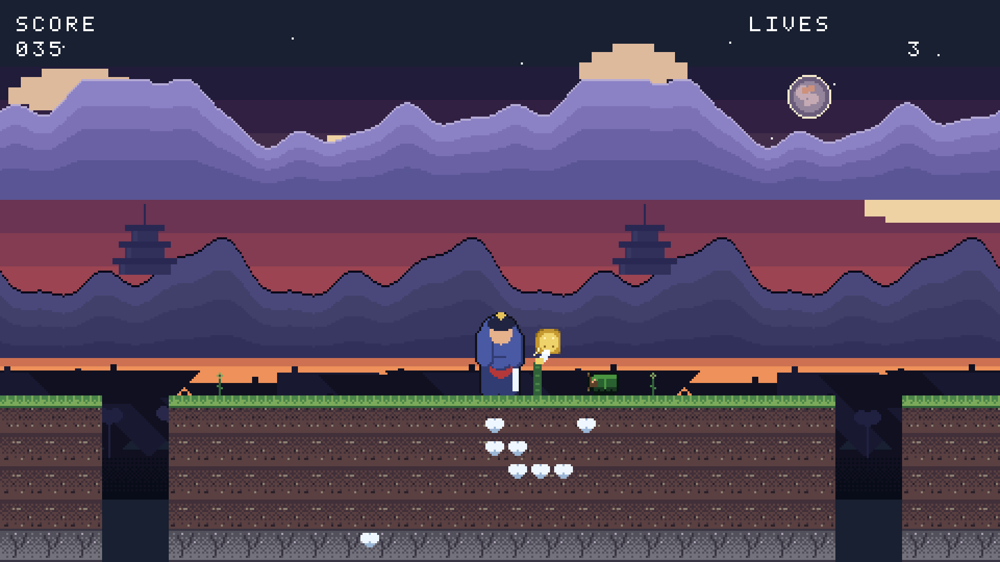

# The art pass — Petal Blade's hero, rebuilt with the rig

ROADMAP_V4 card 7.7: the round-5 game's hero, rebuilt with the rig
animator (card 7.4), plus five props built from `.px` pixmaps (card 7.3).
The world — the parallax, the tiles, the enemies, the coins — stays the
procedural art it was.

* **Before** (the promoted game, the hand-drawn procedural hero):
  
* **After** (the rig variant, `programs/petalblade_rig.c`):
  

Both are the same session (`tests/inputs/petalblade.txt`, frame 500) at
4x — 1920×1080. The gameplay is identical: the same level, the same
physics, the same story (die → START → win at the torii with 70 points);
only the hero and the props differ.

## What was built

| | |
|---|---|
| the hero | `art/rigs/samurai.json` — 13 parts, 8 states, 28 frames |
| the props | `art/px/props/*.px` — a lantern, a torii, bamboo, a stone, a banner |
| the palettes | `art/palettes/hero16.json` (the round-5 hero palette, verbatim) and `props16.json` (the scenery palette) |
| the build | **one command**: `make art-petalblade` (`tools/build_petalblade_rig.py`) |
| the variant | `programs/petalblade_rig.c` + `programs/petalblade_rig/` (the build truth) |
| the test | `tests/test_petalblade_rig.sh` — the same story, the same determinism, the same record→replay |
| the golden | `tests/golden/petalblade_rig.txt` — 1202 frames; **the promoted game's golden is untouched** |

## The numbers

| | |
|---|---|
| assets in the variant | 24 sprites (8 hero states, 5 props, 11 world) + 11 animations |
| the rig | 13 parts, 8 states, 28 frames, **190 hand-tuned numbers** (94 in the parts, 96 in the poses) |
| the props | 5 pixmaps, 68 lines of pixel data in total |
| ROM | 66 068 bytes (the promoted game: 60 000) — 25 % of the 256 KiB budget |
| the build | one command, byte-deterministic: the same inputs give the same bytes |
| time | about 3 hours, of which the rig itself was the first hour |

**190 hand-tuned numbers** is the number to look at. The procedural hero
had no numbers at all — it was code that painted a picture, and changing
the walk cycle meant changing the code. The rig's numbers are all in one
file, and each one is a thing a person can argue about ("the leg is 13
pixels, the shoulder plate is 17 wide, the attack winds up to −80°"). That
is the rig's real advantage: **not the art, the editability**.

## The honest verdict

**No — the rig hero does not look as good as the procedural one.** The
procedural hero is a samurai: a kabuto with a crescent maedate, a drawn
face, armour plates, crimson lacing, a katana over the shoulder, eleven
hand-posed frames with a rim light. The rig hero is a **hooded figure**
with a gold dot on its head (the maedate) and a white stick (the katana).
At 4x in the world it reads as "somebody in a dark blue robe"; the
procedural one reads as "a samurai". That is not a close call.

**Where it is worse, specifically:**

1. **The silhouette is a bell.** The rig's legs are capsules under a wide
   torso, and a hakama-shaped mass swallows them — the walk cycle's stride
   is invisible in the finished figure. The procedural hero's legs are
   visible, and the walk reads.
2. **The face is a band.** The kabuto is an ellipse and the head is an
   ellipse; where they overlap you get a horizontal stripe of skin, not a
   face. The procedural hero has eyes.
3. **There is no rim light.** The procedural hero has a lit edge on the
   dark side; the rig's `shade` tone is a flat 1-pixel band, which reads
   as an outline, not as light.
4. **The detail budget is spent on the wrong things.** 28 frames of
   animation cost the same as 11, and every frame carries the same crude
   shapes. The procedural hero spent its pixels on one good pose.

**Where it is better:**

1. **Consistency.** Every frame of every state is the same character by
   construction. The procedural hero's eleven frames were hand-checked;
   the rig's twenty-eight are free.
2. **Editability.** 190 numbers in one file, and the walk cycle's timing
   and arc are a line of JSON. Changing the hero's proportions is changing
   a number, not rewriting a painter.
3. **The props are a different story.** The five `.px` props (a lantern, a
   torii, bamboo, a stone, a banner) are *better* than the world's
   procedural equivalents in one specific way: they are editable by
   anyone who can type a grid, and they are consistent by construction.
   The bamboo in the "after" shot is a `.px` pixmap, and it reads as
   bamboo.

**The conclusion I would take into card 7.8:** the rig is the right tool
for *consistency and iteration*, and the wrong tool for *beauty at this
size*. A 28×40 pixel character has room for maybe four shapes and an
outline; the procedural generator, which could paint a face and a rim
light, was buying something the rig cannot.

So the pipeline's shape should be: **the rig for the animation, the
canvas (or a `.px`) for the detail** — and the honest next step is to
learn how to put a *drawn* head on a *rigged* body.

## Reproducing it

```sh
make art-petalblade                       # the assets, byte-deterministic
make programs/build/petalblade_rig.arc1  # the game
build/arcade1 run programs/build/petalblade_rig.arc1 \
    --input tests/inputs/petalblade.txt --frames 500 --capture shot.png --scale 4
```

The review checklist for the rig itself is in
[art/reports/humanoid.md](../../art/reports/humanoid.md); the checklist
every review follows is in [art/CRITIQUE.md](../../art/CRITIQUE.md).
