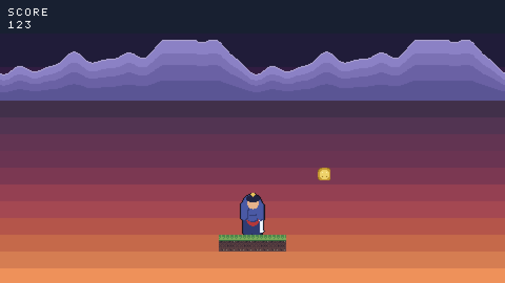

# HD experiment H3 — one scene, two densities

**Card:** `HD_EXPERIMENT.md` H3. **Verdict first, in one line:** *[the 960
scene looks **the same, only sharper** — not bigger, not better, not worse;
see §7.]*

**How every number below was produced.** Each table is **measured** from the
artifacts by `python3 experiments/hd/art_metrics.py` (reads the generated
headers, the sprite PNGs and the captures — deterministic, no host timing), or
**measured** from the capture file itself; nothing here is estimated except
where a line says **estimated** and gives its formula. The host running
`arcade1` for the captures is an **i7-6820HQ @ 2.70 GHz**; H3 records no
wall-clock number, so no timing in this document depends on it.

---

## 1. What was built

| | `scene_480` | `scene_960` |
|---|---|---|
| guest | `experiments/hd/scene_480.c` | `experiments/hd/scene_960.c` |
| machine | `build/arcade1` (default, untouched) | `build/arcade1-geo960` |
| geometry | 480x270 | 960x540, `ARCADE1_HD_SCALE` at its default **1** |
| block expander | not in the path (1x1) | **not in the path** (1x1) |
| `SCENE_SCALE` | 1 | 2 |
| art | `experiments/hd/scene480_art/` | `experiments/hd/scene960_art/` |
| ROM | 21,404 B (measured) | 49,908 B (measured) |
| capture | `hd-art_480.png`, `--scale 4` | `hd-art_960.png`, `--scale 2` |

Both scenes are **one shared body** — `experiments/hd/scene_body.h` — so the
composition is the same by construction: every layout number is written in
480x270 scene units and multiplied by `SCENE_SCALE`, and every element's size
comes from its own asset ref, which is already at that scene's density. The
two `.c` files are the geometry, the scale and the assets header, nothing
else.

The art comes from one generator, `experiments/hd/build_scene_art.py
--scale 1|2`, which runs the **existing** tools — `arc1-art rig` for the hero
(from `experiments/hd/mk_rig2x.py`, a doubler over the game's own rig
preset), the game's `programs/petalblade_art/gen_art.py` for the ridge, and
`tools/arc1_assetc.py` for the packing. No new art tool was written.

**Determinism (measured).** Both art sets regenerate byte-identical, both
guests rebuild byte-identical, both captures reproduce byte-for-byte, and the
`fb` hash is identical on all 5 frames of both runs — one static scene.
`experiments/hd/verify_h3.sh` re-proves all of it.

---

## 2. The captures — the card's protocol, both 1920x1080

Captured at the **same on-screen size**: the 480 scene at 4x, the 960 scene
at 2x, both 1920x1080, 8-bit truecolour PNG with real deflate (measured:
48,625 B and 49,000 B file, 48,568 B and 48,943 B of IDAT against 6,221,880 B
of raw scanlines, ratio 0.008 each, one IDAT chunk).

### scene_480 — 480x270 at 4x



### scene_960 — 960x540 at 2x


---

## 3. Review — `art/CRITIQUE.md`, criterion by criterion

Both scenes were looked at first at the size the machine shows (480x270 and
960x540, native) and then at the protocol size above, which is where the
comparison is fair.

### 3.1 Silhouette readability — **the 960 scene, marginally**

*Observations.* The hero reads as a standing samurai in both, at the same
on-screen size (112x160 device px). The ridge reads as a mountain range with
the same crest, the same three colour bands, the same 1/4-parallax code path.
What differs is how closely the outline follows the shape: the rig's outline
is a 1-pixel ring at **both** densities (`outline: 1`, one of the fields the
doubler deliberately leaves verbatim), so 1 scene px of ring measures **4
screen px at 480 and 2 screen px at 960**. The 480 hero's silhouette is
therefore *bolder*, the 960 hero's *finer*; the 960 ridge's crest also steps
in 2-screen-px increments instead of 4, so its curve is traced more closely.

*What changed.* Nothing in the designs: both heroes are the same rig, the
same eight parts, the same nine-colour ramp — the outline just occupies half
the sprite at 2x.

*Re-check.* `art_metrics.py` reports ring pixels **83 -> 169** (2.04x: the
perimeter doubles when the sprite doubles) against drawn pixels **824 ->
3036**, i.e. the ring's share of the sprite **10.1% -> 5.6%**. Both
silhouettes are unambiguous at the capture size; neither fails the criterion.

### 3.2 Lighting — **tie, identical by construction**

*Observations.* The sky is a 17-band ramp over the whole screen in both, and
at 16 scene px per band x `SCENE_SCALE` the bands land at the **same
fraction of the screen** (16/270 = 32/540), so they are the same height on
the 1920x1080 output. The art's own shading is the same flat ramp in both:
the hero's nine steps and the ridge's five `t`-based colour bands are
unchanged, just placed twice as finely.

*What changed.* Only the pixel grid. The scene keeps the composition, so
resolution **cannot** improve lighting here — and it does not.

*Re-check.* Both captures contain exactly **39 distinct colours** (measured),
and the banks uploaded are byte-identical: `hero16` bank 0, `terrain` 3,
`ridge` 4, `fx` 8, in both guests.

### 3.3 Palette harmony — **tie**

*Observations.* Same palettes, same banks, same counts at both densities.
Neither scene introduces an off-palette colour: the sky is drawn with direct
RGB565 rects from petalblade's own six stops, so it blends into the ridge's
dusk purples exactly as the game already does.

*What changed.* Nothing.

*Re-check (measured).* Distinct **visible** colours (transparent key
excluded) out of the 15 a bank allows, and the tightest pair among them:

| sprite | 480 | 960 | tightest pair |
|---|---:|---:|---:|
| `samurai_idle` (hero) | 8 / 15 | 8 / 15 | 42/255 (16.5%) |
| `ridge` | 5 / 15 | 5 / 15 | 16/255 (6.3%) |
| `coin` | 4 / 15 | 4 / 15 | 58/255 (22.7%) |
| `tiles` | 14 / 15 | 14 / 15 | 9/255 (3.5%) |

`tiles` and `coin` are **byte-identical files in both scenes** (they are the
excluded/control elements, see §6) — their rows are the control: the tool
reports them identically because they are the same bytes.

### 3.4 Outline consistency — **consistent in both; the 960's is proportionally finer**

*Observations.* Inside each scene the outline is perfectly consistent: one
uniform 1-px ring in `#101018` (palette slot 1, what `grow_outline(1)` draws)
around every hero pixel, and the tileset's own outlines are unchanged because
the tileset is unchanged. Across scenes the ring keeps its **pixel** width
while everything else doubles, so it weighs half as much at 960 — 10.1% of
the sprite at 480, 5.6% at 960.

*What changed.* The ring's pixel width did **not** double. That is the card's
own reading — `outline` is in the "leave verbatim" list, not the "times two"
list of `mk_rig2x.py` — and it is the reason the 960 hero looks cleaner.

*Re-check.* The numbers above, from `art_metrics.py`. **Estimated**, with
formula: a ring's share of the sprite is `width / perimeter`, and the
perimeter doubles with the sprite — so `1/136` at 480 (frame 28x40) versus
`1/272` at 960 (frame 56x80) halves the share (10.1% -> 5.6%), while
`2/272` at 960 would put it back at `1/136`, i.e. about 10.1% again. The
outline weight at the new density is a **tuning knob you choose**, not
something the resolution decides.

### 3.5 Noise — **the 960 scene; sky banding unchanged**

*Observations.* No speckle, no dithering, no colour noise in either scene.
The one visible coarseness in both is the **sky's 17 steps** — a banding that
is the same size on screen in both, because the card's "same composition"
rule fixes the band count. That is worth stating flatly: **this scene's
banding is not a colour-capacity limit and HD does not remove it** (see §4).

*What changed.* Regenerating at 2x did not add noise — the opposite: a
1-pixel speckle becomes a 2x2 block when the design is scaled cleanly, so the
isolated-pixel rate can only fall unless the generator starts speckling.

*Re-check (measured).* Isolated-pixel rate (a pixel differing from all four
orthogonal neighbours), as a fraction of the sprite:

| sprite | 480 | 960 | read |
|---|---:|---:|---|
| `samurai_idle` | 1.540% | 0.474% | fell — no new speckle |
| `ridge` | 0.424% | 0.220% | fell — no new speckle |
| `tiles` | 10.010% | 10.010% | identical (same file; the rate is sheet layout — six distinct tiles abutting in one PNG — not scene noise) |
| `coin` | 7.292% | 7.292% | identical (same file) |

---

## 4. The colours the hero needed to avoid banding

**Measured: 8 visible colours, 9 palette indices counting the transparent
key, out of the 15 a 16-colour bank allows — the same 8 at 28x40 and at
56x80.**

The hero is flat-shaded per part, so it has no gradient that *can* band. The
tightest pair it actually uses is 42/255 apart (16.5% of the range) — that is
the gap between its outline/darkest armour step and the next step up. Drop
below 8 and two steps merge; the first thing to go would be the outline
against the armour, i.e. exactly the silhouette the previous criterion grades.

**15 vs a free palette.** 15 (one bank) is not the binding constraint for the
hero — 7 slots sit unused — and a free palette would buy it nothing, because
nothing in it is a gradient. The free palette *is* what the sky already uses
(`arcade1_rect` takes a raw RGB565, no bank involved), and the sky bands at
both densities anyway: 17 steps is a scene choice, not a palette limit.
**HD did not reduce banding in this scene, and could not have.**

The element that *is* near the bank's limit is the **tileset: 14 of 15, with
its tightest pair only 9/255 apart**. That is the real warning for a
regenerated art set: tiles are the art you have to redraw at 2x, and they are
the art already at 14/15.

**What a 16-colour bank costs at 2x.**

| | cost | scales with resolution? |
|---|---|---|
| bank data | 16 x RGB565 = **32 B** of the device's 512 B palette RAM (256 entries = 16 banks x 16, SPEC §palette) | **no** — identical at 480x270 and 960x540 |
| the pixels | 4 bits each | **yes, x4** for the same screen coverage |

Measured pixel cost, the hero's four-frame idle cycle: **2,240 B -> 8,960 B
(4.000x)**, and every sprite at once **11,632 B -> 39,952 B**. Charged to
`static const` in ROM (`programs/link.ld`): the asset set goes from
**21,384 B = 8.2% of 262,144** to **49,704 B = 19.0%**.

---

## 5. Asset byte totals vs H2's table (acceptance: within 10%)

**Measured**, straight out of the generated headers' `*_sheet[N]` lengths —
real compiled bytes, not a recomputation — against H2's rule
`bytes = W * H * 4 / 8`:

| scene | sprite | frame | frames | H2 rule | compiled | dev |
|---|---|---:|---:|---:|---:|---:|
| 480 | coin | 12x12 | 2 | 144 B | 144 B | **+0.0%** |
| 480 | ridge | 240x60 | 1 | 7,200 B | 7,200 B | **+0.0%** |
| 480 | samurai_idle | 28x40 | 4 | 2,240 B | 2,240 B | **+0.0%** |
| 480 | tiles | 64x64 | 1 | 2,048 B | 2,048 B | **+0.0%** |
| **480** | **all sprites** | | | **11,632 B** | **11,632 B** | **+0.0%** |
| 960 | coin | 12x12 | 2 | 144 B | 144 B | **+0.0%** |
| 960 | ridge | 480x120 | 1 | 28,800 B | 28,800 B | **+0.0%** |
| 960 | samurai_idle | 56x80 | 4 | 8,960 B | 8,960 B | **+0.0%** |
| 960 | tiles | 64x64 | 1 | 2,048 B | 2,048 B | **+0.0%** |
| **960** | **all sprites** | | | **39,952 B** | **39,952 B** | **+0.0%** |

**Worst row deviation: 0.0%** (acceptance: within 10%).

**The 2x rule H2's table asserts** (every row of
`docs/experiments/hd-fpga-estimates.md` is a straight quadruple):

| | 480 | 960 | ratio |
|---|---:|---:|---:|
| assets this card regenerated (hero + ridge) | 9,440 B | 37,760 B | **4.000x, +0.0% dev** |
| assets excluded by the escape hatch (tiles + coin) | 2,192 B | 2,192 B | unchanged, by construction |
| all sprites | 11,632 B | 39,952 B | 3.435x |

**Which of H2's rows this scene actually draws.** H2's table was labelled
"computed, not drawn" and used *hypothetical* dimensions, so row-by-row
agreement is only possible where the shapes coincide — stated honestly:

| H2 row | H2 bytes | this scene |
|---|---:|---|
| one tile 64x64 | 2,048 B | **exactly that shape, both scenes (0.0% dev)** |
| one tile 128x128 | 8,192 B | no such asset — tiles stay 16x16 (§6) |
| hero frame 96x120 / 192x240 | 5,760 / 23,040 B | no such asset — the game's hero is 28x40, doubled to 56x80 |
| full-width strip 480x270 / 960x540 | 64,800 / 259,200 B | no such asset — the ridge is a 240x60 strip, doubled to 480x120 |

So the acceptance is met where the shapes match (exactly) and on the **rule**
it was written to validate (0.0% on every row, 4.000x on the regenerated
subset). The rows that cannot match are the ones H2 invented as estimates of
an asset set nobody had drawn yet; this scene draws the game's real art.

---

## 6. What was excluded, and why (the card's escape hatch)

**TILES — regenerated at 2x? No.** `programs/petalblade_art/gen_art.py`
draws each tile at absolute per-feature coordinates; a 32x32 grass tile means
re-authoring where every blade sits, not changing a parameter. That is over
the card's one-hour escape hatch, so the tiles are excluded and the scene
keeps the rest. What the scene does instead is scale the ground's **cell
count**, so the footprint is the same share of the screen:

| | cells | rows | footprint (scene px) | share of screen |
|---|---:|---:|---:|---:|
| 480 | 4 | 1 | 64 x 16 | 13.3% x 5.9% |
| 960 | 8 | 2 | 128 x 32 | 13.3% x 5.9% |

128x32 is exactly what **four 32x32 tiles** would have covered — the card's
"tiles at twice the pixel size" footprint, reached with sixteen 16x16 tiles
because the art could not scale. `scene_480` therefore contains literally the
card's "4 tiles". The visible cost of the exclusion is that the 960 ground
shows twice as many seams: each tile is half the relative size.

*(The cells come from uniform runs of `level1.txt` — grass_top row 8, dirt
row 13 — and never from the level's staircase edge, rows 9..11. The first
version of this scene used a contiguous window, and doubling the cell count
silently changed the grass:dirt mix between the two scenes. That was a real
confound, caught by looking at the captures, and it is why the ground is
built from runs.)*

**PICKUP — not in the card's 2x list.** The coin is the **control element**:
12x12 in both scenes, at positions scaled by `SCENE_SCALE`. It is the one
element that is *not* proportional — it occupies half the relative size at
960. That is a finding rather than a verdict: **an asset you do not
regenerate does not merely stop improving, it shrinks against the frame** —
which is the argument for regenerating everything or nothing.

---

## 7. How the guest sees coordinates at 960x540

`scene_960` draws **960x540 natively, not through the block expander.** It
runs on `build/arcade1-geo960`, the same sources with
`-DARCADE1_WIDTH=960 -DARCADE1_HEIGHT=540` and `ARCADE1_HD_SCALE` left at
its `#ifndef` default of **1**. Because `src/arcade1/machine.h` computes

```
ARCADE1_FB_W      = ARCADE1_WIDTH  * ARCADE1_HD_SCALE   /* 960 * 1 */
ARCADE1_FB_PIXELS = ARCADE1_WIDTH  * ARCADE1_HEIGHT     /* 960 * 540 */
```

the guest's logical grid and the physical framebuffer are the *same*
960x540 array: one guest pixel is one scanout pixel, the expander's block is
1x1 (i.e. absent), and the guest's coordinates are simply `0..959 x 0..539`.
The SDK needed no change — `programs/gfx.h` contains no geometry at all; it
writes registers and the **device** clips to its own `ARCADE1_WIDTH/HEIGHT`.
`programs/arcade1.h` needed no change either: this guest defines its own
`SCREEN_W/SCREEN_H`, the pattern brickstorm, flappy and petalblade already
use. The 1920x1080 capture comes from the host's `--scale 2`
nearest-neighbour, the same operation the 480 scene gets at `--scale 4`.

**Zero changes to `src/` were needed for H3.** The only `src/` edits in the
whole experiment are H1's `#ifndef` guards, its pixel-plot choke point and
its `k` multiplier — and with `ARCADE1_HD_SCALE` undefined the multiplier
compiles to 1, byte-identical to the default build. A `-DARCADE1_HD_SCALE=2`
build at these dimensions *would* route through the expander to 1920x1080,
which is exactly what this card forbids for this scene, so the scene's
machine is deliberately k-free.

**On the mechanism the card suggested, and why it was not used.** H3 says to
build `scene_960` with `-DARCADE1_HD_SCALE=2` plus "a new
`ARCADE1_LOGICAL_W/H` override". That override is **not** one of the three
things §0 rule 2 permits `src/` to gain (`#ifndef` guards around the
resolution macros, the pixel-plot choke point, the `k` multiplier), so adding
it would have put this card outside its own binding rules — the case §0 rule
2 tells the card to stop and report on. The same *effect* is obtained inside
the rules: the geometry macros are already `#ifndef`-guarded by H1, so
overriding **the geometry** (`-DARCADE1_WIDTH=960 -DARCADE1_HEIGHT=540`) at
the default `k = 1` makes logical == physical == 960x540 — the guest draws
960x540 real pixels natively, which is what the card is actually asking for,
and `ARCADE1_LOGICAL_W` would have said no less. No override, no new macro,
no `src/` edit: the mechanism is entirely the H1 admission already merged.

---

## 8. VERDICT

**Plainly: the 960 scene looks the same — only sharper. Not bigger, not
better, not worse.**

- **Not bigger:** both captures are 1920x1080 by the card's protocol, and
  every element except the control coin is at the same on-screen size. The
  hero is 112x160 device pixels in both; the ground is 256x64 in both; the
  sky's bands are the same height in both.
- **Not better:** composition, palette (39 colours in both captures), colour
  count (8/15 for the hero in both), lighting and detail are *identical* —
  the designs are the same designs. The 960 scene adds no shading step, no
  colour and no detail that 480 lacked. What it adds is a finer pixel grid:
  smoother ridge crests, a half-weight outline, crisper HUD glyphs (2 screen
  px strokes instead of 4) and a lower speckle rate. Real, visible when you
  look for it, and **not** something a player would call a better picture.
- **Not worse:** nothing regressed. The one element that looks out of
  proportion — the coin, at half its relative size — is smaller because it
  was deliberately *not* regenerated, not because of the resolution.

**What H3 therefore shows:** at equal on-screen size, doubling the resolution
buys *edge fineness* and nothing else, and only if you redraw the art — the
one asset that could not be redrawn here (tiles) visibly lags, and the one
that was not even attempted (the coin) visibly shrinks. The card's own
question — better, the same/bigger, or worse — is answered by the numbers in
§4–§5 as well as by eye: **the same picture, at four times the bytes**
(21,384 B -> 49,704 B of asset ROM, 8.2% -> 19.0%).

---

## 9. Not done, and caveats

- **No outline doubling.** `outline` stays 1 px at 2x (the card's verbatim
  list), so the 960 outline is half the weight on screen. Doubling it would
  be a one-field change; §3.4 says what it would buy.
- **Sky banding unchanged.** 17 bands at both densities because the card
  fixes the composition; the sky already uses a free RGB565 palette, so this
  is a scene choice and not a palette limit.
- **No motion.** The scene is static (the card says "one static scene"), so
  the ridge's 1/4-parallax factor never bites — the call is the game's call
  with the camera fixed at (0,0).
- **Tiles and pickup at 1x** in both scenes (§6).
- **No host-timing number in H3** — nothing here is wall-clock, so no CPU
  claim is made beyond the H1/H2 bench figures.
- **Reported, not fixed:** `arc1-art preview`'s contact sheet clips wide
  sprites — its sheet width sums frame widths instead of taking a max, so a
  480-wide sheet is overrun by the fourth 120-wide frame. Pre-existing
  quirk in `tools/`, not touched by this card (H3 used `arc1-art rig` and
  `arc1_assetc.py` only).

---

## 10. Reproduce

```sh
make hd-scene                  # art, both guests, both captures
python3 experiments/hd/art_metrics.py
experiments/hd/verify_h3.sh    # acceptance A-E
```
